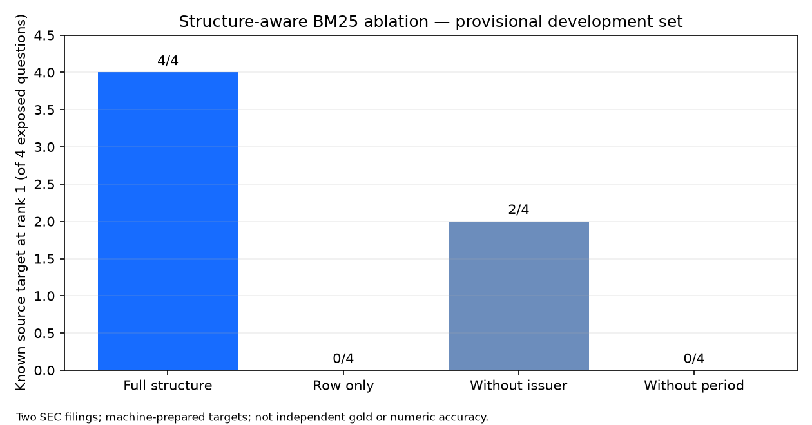

# P4 — Structure BM25 ablation

These are real local Qdrant runs on the same 1,241 source chunks, model and six frozen queries. Each variant rebuilds an index from scratch. The four target rows were exposed during development; all values are **provisional known-target locator counts**. Per-query hits and timings remain in the named JSON files in `../03_IMPROVEMENTS/`.

| Variant | Known target @1 | @5 | @10 | Query p50 ms |
|---|---:|---:|---:|---:|
| Full row + issuer + period context | 4/4 | 4/4 | 4/4 | 13.802 |
| Row text only | 0/4 | 1/4 | 1/4 | 6.952 |
| Without company/CIK lines | 2/4 | 3/4 | 3/4 | 15.391 |
| Without column/reporting-period lines | 0/4 | 1/4 | 1/4 | 12.956 |

The difference suggests issuer and period text are useful **on these four exposed questions**. It does not isolate their effect independently of changed BM25 term weighting. There is no held-out evaluation, human gold, repeated-run confidence interval, financial answer check or complete stage-2 leave-one-out experiment. `MEASURED_SUMMARY.json` and `scripts/topic3_experiment_summary.py` regenerate the table data and plot from run artifacts. The latency values are six-query medians and should not be generalized.
