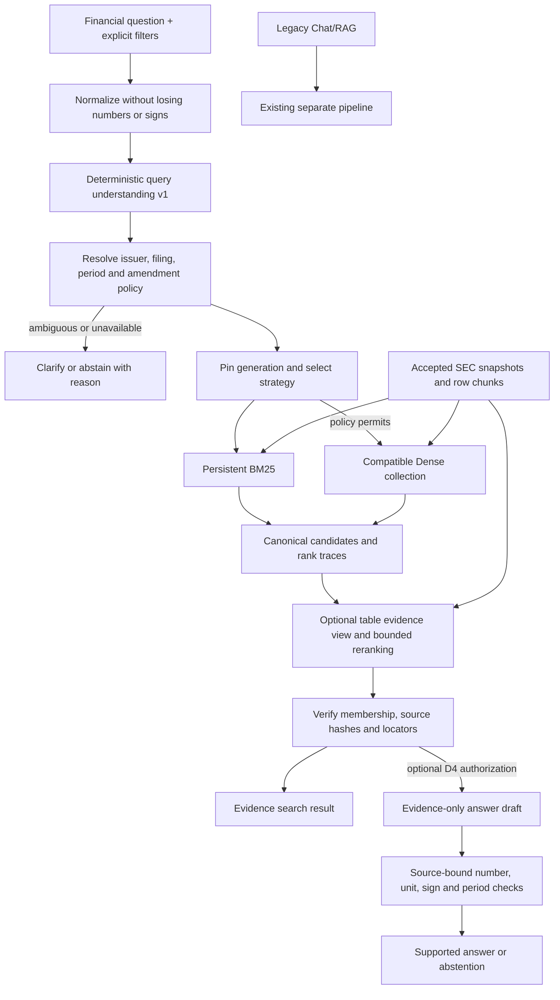

# Proposed architecture and contracts

**Design only; all D names/interfaces below are proposals, not existing modules.** Primary design: conservative BM25-first adaptive retrieval, with explicit source resolution and optional Dense. Alternative: simultaneous lexical/dense/table channels and adaptive fusion (13). Legacy APIs and C defaults remain the compatibility reference.

At ingestion: preserve original B/C artifacts; no D rewrite. At retrieval: initially use existing row chunks and prefilters. At reranking: derive compact views only for retrieved candidates, avoiding a new index for the minimum experiment. A later representation experiment may build a separately authorized derived index; every representation gets a new identity. Table expansion happens before final provenance validation; all added parents/cells are verified, not trusted because their neighbor passed.

## Component boundaries

| Proposed component | Input → output | Dependency / failure boundary |
|---|---|---|
| Normalizer | Raw UTF-8 question → original plus normalized tokens/spans | No model; keep raw values, punctuation/signs, `%`, quoted labels; bounded length |
| Understanding | Normalized question + explicitly supplied filters → `QueryIntent` | Versioned rules/alias map; confidence denotes rule evidence, not calibrated probability |
| Resolver | Intent + generation manifest/catalog → `ResolvedScope` | Explicit UI filters take precedence; conflicts produce error, never broaden scope silently |
| Router | Intent + scope + optional BM25 diagnostics → `StrategyPlan` | Only frozen policies in 06; records reason and configuration hash |
| Retriever | Scope + plan + query → channel `Candidate[]` | C adapter; pin generation once; validate model/representation identity before embedding |
| Ranker | Candidate lists + intent → ranked canonical IDs + trace | Deterministic tie/dedup; cannot invent source IDs or expand metadata scope |
| Evidence assembler | Ranked IDs + row/cell metadata → `EvidenceBundle` | Bounded expansion within same filing/table; tracks all parents, units and quality |
| Provenance gate | Bundle + pinned manifest → verified bundle or typed failure | Existing crypto verification preserved; checks every expanded source |
| Optional answerer | Verified bundle + supported operation → draft with claim/operand IDs | No web/tools/file access; retrieved text is data; no execution of model code |
| Numeric verifier | Typed expression + source-cell operands + scope → result/checks | Decimal allowlist; no arbitrary expression evaluator or inferred missing operands |
| Presenter | Evidence or verified answer → UI/API research response | Clearly shows generation, period, source and extraction warning; no financial recommendation |

## Data contracts (normative design, not executable schemas)

`QueryIntent v1`: raw query and normalized copy; category enum `{exact,paraphrase,terminology,table,comparison,cross_section,ambiguous}`; issuer mentions with offsets; line-item phrases; explicit form; filing-date range; report-period request with `{instant|duration,start,end,fiscal_label,calendar_label}`; amendment policy `{original,amended,specified,unresolved}`; numeric constraints preserving raw/normalized value, sign, scale, currency, percent/percentage-point semantics; operation request; rule IDs, unresolved slots. Missing fields are null, never guessed.

`ResolvedScope v1`: dataset manifest hash; generation ID; parser/chunker identities; issuer CIKs; filing IDs and form; selected report periods/column contexts; amendment links and requested as-of date; source-resolution reasons; completeness/warnings. Filing-level fiscal filters cannot substitute for checking comparative column periods: retain a filing containing an older requested column even when its filing fiscal year differs. Cross-filing comparison returns separately labeled scopes.

`StrategyPlan v1`: policy ID/version/config SHA; channels and budgets; fixed RRF k/weights if used; fallback conditions; deadline and no-model mode. `retrieve(query, scope, plan)` returns canonical parent chunks plus raw channel scores/ranks, collection/model/representation identity and elapsed stage times. `rank(lists,intent,config)` returns stable order and per-channel contributions; no filter relaxation.

`Evidence v1`: evidence ID = content-addressed derivative of parent IDs/hashes + view version + selected coordinates; generation/manifest ID; parent chunk IDs and payload hashes; document version; CIK/company/ticker, form/accession/filing identity; filed date and report period; section/table/caption/header path; raw row/cell strings, row/column coordinates, contextRef/unitRef/numeric attributes; raw signs/parentheses; normalized numbers with derivation and uncertainty; footnotes/continuation references; source URL and structural path; extraction status at filing/table/row levels; channel rank trace; verification status/time. Derived view never overwrites the original text or hash.

`EvidenceBundle v1`: query/scope/plan, evidence array, coverage by required operand/period/section, truncation flags, warnings, verification identity. `DraftClaim v1`: text, kind `{extract,compare,define,summarize}`, source evidence/cell IDs, optional typed expression, no confidence-only acceptance. `VerifiedAnswer v1`: supported claims, decimal results/unit/period, citations, checks, abstention reason, generation/contract identities. `verify(expression, operands, scope)` returns `{pass|fail|unsupported, reason, result, trace}`; all operands must resolve to a verified cell in this bundle.

## Identity, storage and migration

Initially no new persistent dependency. Research run artifacts record input/config hashes and traces outside accepted indexes. Future derived collections would use a distinct D namespace; identity includes parent manifest, parser/chunker, representation version/hash, model digest/dimensions, document/query prefixes, truncation settings, normalization version and numeric decoder version. Router/ranker versions are also run identities even if embeddings need no rebuild. Changed representation or prefix requires a new vector generation; changed query policy requires a new experiment ID. Never point an old active C generation at D vectors. Rollback is switching a separately validated configuration/generation pair, not mutating old payloads.

Preserve embedded single-process ownership, shared mutation locking, active/pinned/evaluation/rollback retention protection and auth before side effects. Serving reads pin a generation for the whole request; publication during a request must not mix members/vectors. A future experiment namespace receives an explicit disk budget and retention decision; no collection deletion is authorized now. Public schemas/routes are not changed by this proposal; a future opt-in versioned research interface requires approval and compatibility tests.

## Failure and isolation policy

Unknown issuer, contradictory filters, ambiguous fiscal period or unresolved original/amended choice → clarification. Empty eligible corpus → no evidence. Dense model/collection mismatch → fail the Dense experiment; production-style optional fallback may return clearly labeled BM25 only, never call that Hybrid. Hash mismatch, unresolved source identity or incompatible parser → fail closed for the affected evidence; do not generate an answer from it. Partial extraction → show limitation; answer only when all required cells and contexts are intact, otherwise abstain. Deadline → bounded failure or labeled degraded evidence; never a verified answer badge on an unchecked draft.

Legacy Chat/RAG retains its existing collection, ingestion and answer path. It does not acquire financial verification claims by sharing an Ollama host. D4 must not send financial questions into legacy RAG as an invisible fallback. No autonomous tools, trading actions, unrestricted Python, cross-request agent memory or distributed coordination is proposed.
