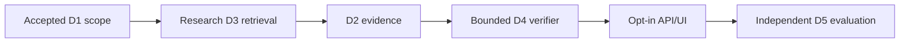

# Owner review package — execution in progress

This is an initial checkpoint, not a final success report. D2 review complete with limitations; D3/D4/D5 NOT_TESTED yet. Do not merge PR11/9. Continue from execution_manifest.json and checkpoint ledger. A final appended stage summary will distinguish real operation, synthetic diagnostics, blocked dependencies, exact Draft PRs and CI.

## D3 checkpoint addition

D3 checkpoint appended: research implementation and real-source BM25 diagnostics exist, full scientific comparison blocked. D4/D5 still NOT_TESTED at this point. See d3 reports and machine checkpoint events; continue automatically after final D3 CI, no stage merge.
