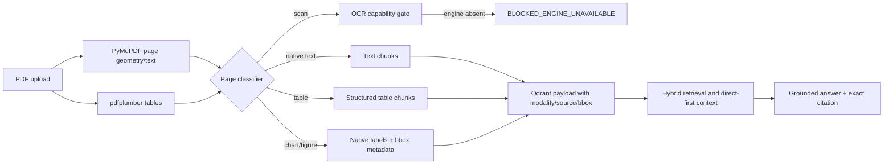

# Universal multimodal PDF RAG architecture

`pdf_service.py` tạo schema trang và modality metadata; `chunk_service.py` tạo chunk theo modality; `qdrant_service.py` lưu payload; `rag_service.py` chấm trọng số modality và tạo inspector. `calculation_service.py` kiểm chứng các phép tính bảng an toàn. API inspector ở `app/api/documents.py:82` và preview ở dòng 92; giao diện bắt đầu ở `client.py:167`.

Biểu đồ chỉ dùng chữ và số tồn tại trong PDF native. Hệ thống không ước lượng giá trị từ pixel và hiện không có model Vision. Trang scan được phát hiện nhưng môi trường không cài OCR engine, nên trả trạng thái blocked có giải thích thay vì tạo nội dung giả.
